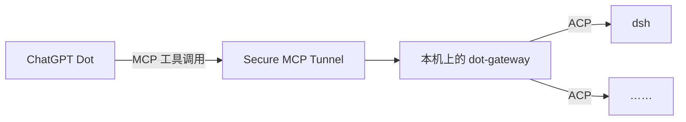

# dot-gateway

让 ChatGPT Dot 通过 OpenAI Secure MCP Tunnel，跟本机的编码 agent（默认是 DeepSeek Harness `dsh --profile acp`）进行**多轮会话**。Dot 可以一轮接一轮地追问，agent 会记得上下文；网关重启、机器重启以后，用同一个 `sessionId` 还能接着聊。

## 架构



Dot 只会 MCP，网关负责翻译：对上用 MCP 和 Dot 说话，对下用 ACP（Agent Client Protocol）和各个 agent 说话。工具照 ACP 会话动作命名，任何走 stdio 的 ACP agent 写进配置就能接入。

## 快速开始

```sh
cd ~/Workspace/dot-gateway
uv sync
scripts/start.sh          # 前台运行，监听 http://127.0.0.1:8765/mcp（Streamable HTTP）
uv run pytest -q          # 单元测试，用假 agent，不花钱
```

tunnel-client 用 `--mcp-server-url http://127.0.0.1:8765/mcp` 连过来。部署、开机自启、配置项和技术细节见 [AGENTS.md](AGENTS.md)。

## P1 配置与限制

将 `agents.example.toml` 复制到 `~/.config/agent-gateway/agents.toml`，按实际安装位置修改命令数组；也可以通过 `DOT_GATEWAY_AGENTS_FILE` 指定文件。配置文件存在时只加载其中声明的 agent；没有该文件时沿用旧版 JSON 配置和内置 dsh。每个 agent 的 `policy` 默认为 `full`，可设为 `operator`；`approval_timeout` 默认为 600 秒，`max_sessions` 默认为 4。`cwd_roots` 可在 agent 内覆盖全局的 `defaults.cwd_roots`，全局默认只允许 `~/cyq`。

网关只向子进程传递基础环境变量及 `env_allow` 中列出的变量，旧 JSON 部署也经过同样的白名单；如需代理，须将 `HTTP_PROXY`、`HTTPS_PROXY`、`NO_PROXY` 等加入 agent 的 `env_allow`。agent 和模式显式配置的环境变量也经过密钥名称过滤：名称包含 KEY、TOKEN、SECRET、PASSWORD 或 CREDENTIAL 的变量会被剔除并记录 warning。`secret_env` 目前只校验、不注入；配置中禁止包含 `DEEPSEEK_API_KEY`。Claude 和 Codex 使用中转服务时可能依赖它们各自的配置文件，需在目标 Mac 上验证实际认证与调用。

每个 HTTP 请求体上限为 1 MiB，最多同时运行 4 个 prompt，每个会话最多一个。`max_sessions` 统计正在启动或存活的 agent 进程，包括空闲会话和 `list_sessions(source="agent")` 的临时进程。审计文件默认位于 `~/Library/Logs/agent-gateway/`，可用 TOML 的 `defaults.audit_dir` 修改，环境变量 `DOT_GATEWAY_AUDIT_DIR` 优先；新建目录为 0700，已有目录权限过宽时只警告、不修改，审计文件为 0600。审计记录包含经脱敏的 prompt 摘要；`prompt_sha256` 对未经脱敏的原文计算。审计写入失败只记录错误，不中断操作。事件日志和 agent 自己的历史不属于审计日志，不保证同样脱敏。

## 工具

| 工具 | 作用 |
|---|---|
| `start_session(cwd, prompt?)` | 开一个会话；带 prompt 时发出去就返回，不等跑完 |
| `prompt(sessionId, text)` | 同一个会话的下一轮；一轮没结束再调会返回 `SESSION_BUSY`。响应回显这一轮实际生效的 `permissionMode`/`permissionPolicy`，`operator` 下另带 `permissionNote` |
| `get_events(sessionId, view?, includeToolOutput?)` | 轮询结果。默认 `view=final`：只给状态，这一轮结束时给一次最终答复，该视图不分页事件；`messages` 给合并后的整条消息和工具调用，`full` 给原始事件，这两个视图才按 `afterSequence` 翻页；`includeToolOutput=true` 附带有界的工具输出摘录；等审批时带 `pendingPermissions`（含 `toolCallId`、回填的一行工具摘要、完整命令、`sandboxPermissions`/justification（如有）、`approvalSource` 和 Auto review 的 `review`）；Auto review 会话还带 `reviewMode`/`toolReviews` |
| `get_tool_call(sessionId, toolCallId)` | 某次工具调用的完整输入和输出；有 Auto review audit 时附 `review` |
| `get_session` / `list_sessions` | 会话概况；`detail=full` 带每一轮的完整答复 |
| `load_session` | 接回会话（dsh 用 `session/resume`） |
| `cancel_prompt` / `close_session` | 中断这一轮 / 结束会话 |
| `set_config_option`、`resolve_permission`、`list_agents` | 切换模型等配置、回答权限请求、列出 agent |

返回值默认是一段紧凑的 JSON（不额外返回 `structuredContent`；部署设置 `DOT_GATEWAY_STRUCTURED_OUTPUT=1` 后会同时返回 structuredContent）。最终答复只投递一次，如果没收到，传 `includeText=true` 或调 `get_session(detail="full")` 再取一次；`messages`/`full` 也可以用交付时相同的 `afterSequence` 重试那一页。

权限有两层：`permissionMode` 是 agent 自己的沙箱；`permissionPolicy` 只决定网关怎么回答 agent **自己发起**的权限请求，不是每次写入/命令的审批开关。TOML 的 `full` 对应 `allow_all`，`operator` 等待审批并在超时后拒绝；旧版 JSON 部署仍使用其原有默认策略。沙箱允许的操作直接执行，所以 `operator` 下 `pendingPermissions` 为空、`permissionRequests` 为 0 是正常的。

TOML 中设置 `policy = "operator"` 后，调用方只能选择 `operator` 或更严格的 `deny_all`，不能通过启动、加载或单轮请求放宽。TOML 的 dsh 默认继承四种模式及 `DSH_PERMISSION_MODE`；`auto` 仍需安装并使用 Auto review profile，参见下文。

某个调用被沙箱拒绝时，dsh 可以对同一调用重试一次、申请严格更宽一档的沙箱（带 `justification`），执行前由 dsh-acp 桥接成 ACP 权限请求。网关保留 `read_only`、`allow_all`、`deny_all` 和 `operator` 策略；`operator` 只向调用方提供单次允许和拒绝选项。选 allow-once 只放宽该次调用，不改变会话的 `permissionMode`；要整会话换档用 `prompt(permissionMode=...)`。

限制：dsh-acp 的 ACP 请求只带 `toolCallId`，申请的模式/理由只能从工具输入回填（`command`、`sandboxPermissions`、`justification`）；Auto review 的审查理由没有 ACP 字段，网关看不到。

部署可以选择启用 dsh 的实验性 **Auto review**（`dsh --profile acp-auto` + `permissionMode=auto` + `permissionPolicy=operator`）：执行前由模型逐调用审查，低风险直接以 full access 运行，medium/high 被拒时挂起问人。安装与配置见 [docs/auto-review.md](docs/auto-review.md)；vendored profile 会把 reviewer 的 decision/risk/reason 写到本地 audit 旁路，网关在 `toolReviews`/`get_tool_call.review` 里返回；`scripts/test_auto_review.py` 提供 allow/ask/deny 的确定性测试入口。这是实验功能，会多花模型调用，也可能误放行/误拒绝。

## 许可证

[MIT](LICENSE)
